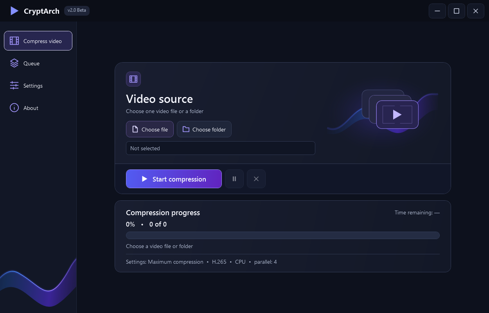

# CryptArch

Compress a video or an entire folder on Windows. CryptArch keeps the originals untouched and preserves the folder structure in the output.

**[Download V2 Beta](https://github.com/xdywnfm-web/CryptArch/releases/tag/v2.0.0-beta.1)** · [Stable v1.0.1](https://github.com/xdywnfm-web/CryptArch/releases/tag/v1.0.1) · **[Читать по-русски](README.ru.md)**



## What it does

- Compress using H.264 or H.265, with three quality presets and your choice of CPU or a supported NVIDIA, AMD or Intel GPU.
- Process 2, 4 or 8 videos in parallel, with progress, an estimated time and pause, resume and cancel controls.
- Set the output folder, review the current batch in the queue and see how output sizes compare with the originals.
- Switch the app between English and Russian in **Settings → Interface language**. The choice is saved.

CryptArch writes MP4 files and does not overwrite existing output. Multiple audio tracks are mixed into one, so alternate languages or commentary will play together. Subtitles and extra video tracks are not carried over.

## Install on Windows

Run `CryptArch-V2-Beta-Setup.exe` from the beta release. It installs separately from v1, normally without administrator rights. Internet access is required during setup to download the pinned FFmpeg build and verify its SHA-256 checksum. The installer is unsigned, so Windows may show a publisher warning.

V2 Beta is a preview for Windows 10/11 x64. Report issues or suggest improvements in [Issues](https://github.com/xdywnfm-web/CryptArch/issues).

## Build from source

The desktop app uses C# / WPF. It runs an isolated Python worker that invokes FFmpeg. You need Windows x64, Python 3.14, PyInstaller and the .NET Framework compiler included with Windows. Install Inno Setup 6 to build the installer.

```powershell
python -m pip install -r requirements-dev.txt
powershell -NoProfile -ExecutionPolicy Bypass -File .\WPF\build.ps1 -ExternalFfmpeg
powershell -NoProfile -ExecutionPolicy Bypass -File .\WPF\build-installer.ps1
```

The installer is written to `release\CryptArch-V2-Beta-Setup.exe`. To run a build locally without the installer, put `ffmpeg.exe` and `ffprobe.exe` in `bin`, then build without `-ExternalFfmpeg`, or make both tools available on `PATH`. Use `python -m unittest -v test_engine` to run the engine tests with FFmpeg available.

## License

CryptArch source is [MIT-licensed](LICENSE). FFmpeg is a separate dependency; the installer fetches it from [Gyan.dev's published release](https://github.com/GyanD/codexffmpeg/releases/tag/9.0.2). FFmpeg's license and build information are installed with the downloaded tools.
