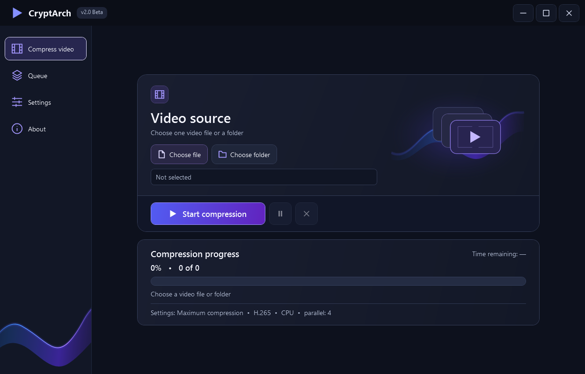

# CryptArch

Сжатие отдельного видео или целой папки на Windows. Оригиналы остаются нетронутыми, структура подпапок сохраняется.

**[Скачать V2 Beta](https://github.com/xdywnfm-web/CryptArch/releases/tag/v2.0.0-beta.1)** · [Стабильная v1.0.1](https://github.com/xdywnfm-web/CryptArch/releases/tag/v1.0.1) · **[English README](README.md)**



## Возможности

- H.264 или H.265, три уровня качества, сжатие на CPU или поддерживаемой видеокарте NVIDIA, AMD либо Intel.
- 2, 4 или 8 параллельных задач, прогресс, примерное время, пауза, продолжение и отмена.
- Выбор папки результата, просмотр списка файлов в очереди и сравнение размеров после сжатия.
- Английский и русский интерфейс. Язык меняется в разделе **«Настройки» → «Язык интерфейса»** и запоминается.

Результаты сохраняются в MP4. Готовые файлы не перезаписываются. Несколько звуковых дорожек сводятся в одну: разные языки и комментарии будут слышны вместе. Субтитры и дополнительные видеодорожки не переносятся.

## Установка

Скачайте `CryptArch-V2-Beta-Setup.exe` со страницы релиза. Бета устанавливается отдельно от v1 и обычно не требует прав администратора. Во время установки нужен интернет для скачивания проверенной по SHA-256 версии FFmpeg. Установщик не подписан: Windows может показать предупреждение об издателе.

Это предварительная версия для Windows 10/11 x64. Сообщения об ошибках и предложения можно оставить в [Issues](https://github.com/xdywnfm-web/CryptArch/issues).

## Сборка из исходников

Интерфейс написан на C# / WPF, движок работает в отдельном Python-процессе и вызывает FFmpeg. Понадобятся Windows x64, Python 3.14, PyInstaller, системный компилятор .NET Framework и Inno Setup 6.

```powershell
python -m pip install -r requirements-dev.txt
powershell -NoProfile -ExecutionPolicy Bypass -File .\WPF\build.ps1 -ExternalFfmpeg
powershell -NoProfile -ExecutionPolicy Bypass -File .\WPF\build-installer.ps1
```

Установщик появится в `release\CryptArch-V2-Beta-Setup.exe`. Для локальной сборки без установщика положите `ffmpeg.exe` и `ffprobe.exe` в `bin` и соберите без `-ExternalFfmpeg`, либо сделайте обе утилиты доступными через `PATH`. Тесты движка: `python -m unittest -v test_engine` (с доступным FFmpeg).

## Лицензия

Исходники CryptArch — под лицензией [MIT](LICENSE). FFmpeg — отдельный компонент, который установщик скачивает из [релиза Gyan.dev](https://github.com/GyanD/codexffmpeg/releases/tag/9.0.2). Лицензия и сведения о сборке FFmpeg устанавливаются вместе с загруженными файлами.
